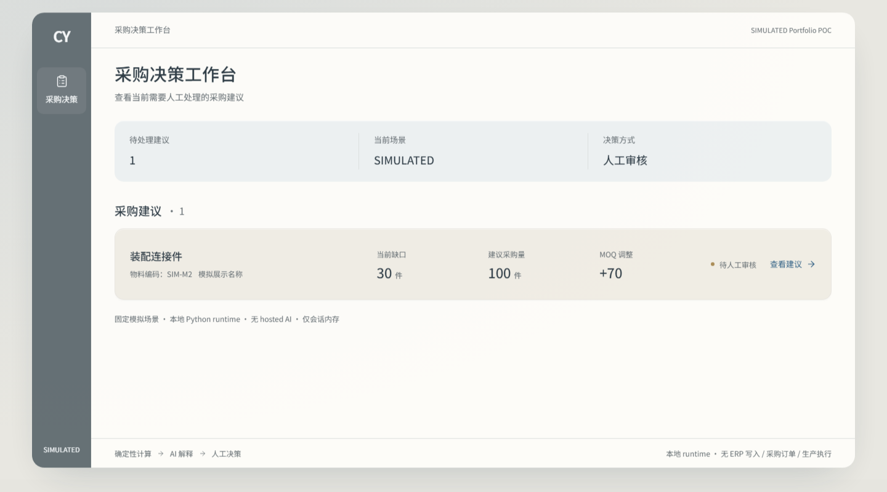
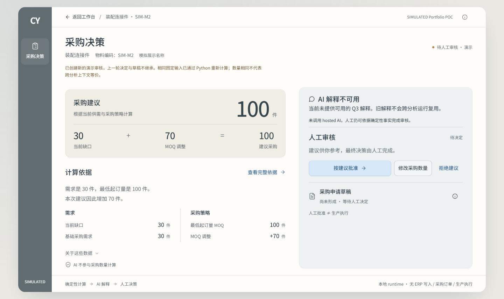
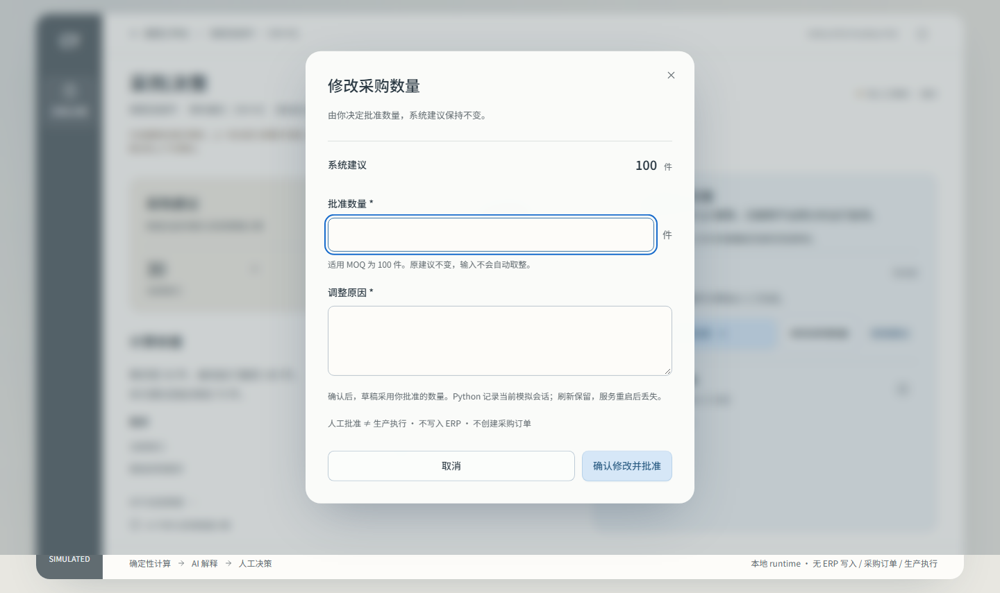

# Supply Chain AI Copilot

**面向制造业供应链的 AI 辅助采购决策支持系统。**

一个独立设计与实现的供应链 AI Copilot，定位为 **SIMULATED Portfolio POC**。它将确定性供应链计算、AI 解释与人在环决策流程（Human-in-the-loop）串联起来：先计算业务事实，再解释证据，最后由人做出决定。



[运行本地演示](portfolio-ui/README.md#启动) · [查看演示内容](#demo-showcase) · [本地验证](#运行与测试) · [架构与证据](#documentation)

**Business value = NOT PROVEN · POC SUCCESS = NOT CLAIMED · Production readiness = NOT CLAIMED.** 本项目用于作品集案例展示，不宣称已完成真实客户验证或部署。

## 业务问题

制造业采购决策需要综合考虑生产需求、BOM 结构、可用库存、在途供应、损耗率、替代物料，以及最低起订量（MOQ）等采购策略。

采购审核人员需要回答：

- 哪些物料会缺料？什么时候会发生？
- 应该采购多少？
- 为什么推荐这样处理？依据是什么？

难点不只是得出一个数字，而是让采购建议可解释、可审核。这些问题构成了方案的业务背景；当前连接演示仅展示一个固定的模拟物料场景，并非实时工厂计划系统。

## 方案概述

**确定性计算 + AI 解释（AI Explanation）+ 人工决策（Human Decision）**

```text
SIMULATED Snapshot → 校验 → 统一数据模型（Canonical Data Model）
                                  ↓
                              确定性计算
                                  ↓
                              采购建议与证据
                                  ↓
                         可选的、经校验的 Q3 解释
                                  ↓
                           人工审核（Human Review）
                                  ↓
                           批准 / 修改数量 / 拒绝
                                  ↓
                         批准后形成绑定决定的决策草稿
```

**确定性核心（Deterministic Core）。** Python 负责需求计算、缺料分析、采购建议与校验。AI 不计算业务事实。业务规则与精确数量由确定性核心处理，让计算结果可测试，也使计算不依赖 AI 是否可用。

**AI 解释层。** 已实现的 Q3 范围使用经校验的结果与证据解释采购数量。AI 不能修改事实、决定采购数量或执行操作。这是范围受限的解释能力，不代表自主工具选择，也不代表所有规划中的业务问题均已验证。当前连接演示默认显示 **AI 解释不可用**，不调用 hosted AI；确定性结果仍可供人工审核。

**人工决策流程。** 审核人员可以按建议批准、填写原因后修改数量（override），或拒绝建议。修改数量时保留原始建议，并遵守既有数量与 MOQ 校验。打开审核时，runtime 创建内部初始草稿（Draft）；批准后，将实际的 Human Decision 绑定到草稿。拒绝不会产生已批准草稿。新的 `AnalysisRun` 会使旧审核与草稿过期（stale），要求重新审核（re-review），且不继承旧决定。

React 通过最小 localhost 边界展示结果并提交用户的明确意图。业务事实与决策状态由 Python 管理。草稿仅保存在服务端内存中；人工批准不执行采购。

<a id="demo-showcase"></a>

## 演示内容

[本地启动指南](portfolio-ui/README.md#启动) 提供构建与启动步骤。演示使用固定 **SIMULATED** 输入，在 localhost 运行。

| 步骤 | 可以查看与操作的内容 |
| --- | --- |
| **1. 工作台** | 识别模拟场景中的缺料，打开对应采购建议。 |
| **2. 详情页** | 查看计算依据：缺口为 30、MOQ 为 100，因此建议采购 100，MOQ 调整量为 70。 |
| **3. AI 解释** | 查看明确的不可用状态。Q3 解释边界已单独实现；当前演示不展示 hosted AI 生成的解释证据。 |
| **4. 人工审核** | 按建议批准 100，或填写数量与原因后修改并批准，也可以拒绝。非法输入不会形成决定，允许修正后重试。 |
| **5. 决策生命周期** | 查看已批准草稿，再选择“模拟新分析运行”，使旧审核与草稿 stale，并开始重新审核。系统重新计算相同的固定输入，不表示输入数据发生更新。 |

**详情页：理解采购建议与依据**



**人工审核：明确输入修改后的采购数量与原因**



以上截图来自已连接的本地 runtime。[桌面、笔记本与手机尺寸截图](portfolio-ui/review/runtime-integration/validation.md#screenshots) 展示的是同一受限演示界面。

## 技术实现

| 部分 | 实现内容 |
| --- | --- |
| **后端 — Python** | Snapshot 加载、校验、统一数据对象、确定性规则，以及人工决策与草稿 runtime。轻量的标准库 localhost 服务将演示连接到既有 runtime。 |
| **前端 — React + TypeScript** | 采购工作台、详情页、证据展示、审核弹窗与草稿生命周期展示。业务校验和状态仍由 Python 管理。 |
| **验证** | Python 自动化测试覆盖确定性规则与 runtime 边界；Playwright 验证连接后的审核流程与响应式界面。CI 验证 Python 测试套件；独立的 UI 工作流按文件路径触发，构建并检查连接后的交互。 |

[已记录的 Runtime Integration 验证](portfolio-ui/review/runtime-integration/validation.md) 包括离线 Q3 stub 检查、会话/stale/重放场景、精确数量传输与失败边界。技术检查不证明 AI 模型质量或业务成果。

<a id="运行与测试"></a>

本地验证可在仓库根目录运行 `python -m unittest discover -s tests -q`。前端构建与 Playwright 命令见[演示指南](portfolio-ui/README.md#验证)。Hosted observation 需要单独的明确授权，不属于默认演示或 CI。

## 我的贡献

**独立项目负责人（Independent Project Owner）**

- **业务与系统设计：** 供应链流程分析、AI 边界设计与 Human-in-the-loop 审核设计。
- **工程实现：** 确定性 runtime、Canonical Data Model、React 集成与测试策略。
- **工程流程：** Issue/PR 工作流、审查流程与 CI 验证。

**AI 辅助开发：** AI coding agents 作为实现助手参与开发。架构决策、任务拆分、审查与最终验收始终由人负责。

## 当前范围与限制

**已实现：** 缺料分析、采购建议、限定范围的 Q3 AI 解释边界、支持数量修改的人工审核、仅存内存的临时草稿生命周期，以及本地 React/Python Runtime Integration。

**未包含：** 真实客户验证、ERP/WMS/MES 集成、数据库持久化、身份认证/RBAC、生产执行或采购订单创建、业务 KPI 衡量。演示中的多个标签页共享一个 Python 内存会话，服务重启后决定与草稿丢失。规则/代码版本新鲜度与整体 AI Eval 仍未解决。

**证据边界：** [历史技术闭环](docs/design/poc-design-v0.2.md#portfolio-technical-closure) 仅适用于已接受版本 `00272580adab8cb8d5843a719d261e34047b877d`。连接演示是版本 `2b5fe6205ebd22c062fc5c6ff10a2908f3689e26` 上单独接受的技术扩展。[当前范围记录](docs/design/poc-design-v0.2.md#historical-closure-connected-extension) 不宣称当前 main 已完成完整 Portfolio Technical Closure，也不宣称这两个版本等价。真实业务场景验证仍为延期事项。

**Business value = NOT PROVEN. POC SUCCESS = NOT CLAIMED.** 不宣称生产就绪或已完成客户验证。

本项目展示企业 AI 应用工程实践，不代表已具备生产部署条件。

<a id="documentation"></a>

## 文档

| 资料 | 延伸阅读 |
| --- | --- |
| **架构 / ADR** | [确定性核心 — ADR-001](docs/architecture/adr-001-deterministic-core.md)、[Q3 解释 — ADR-002](docs/architecture/adr-002-p0-ai-explanation-minimum-runtime.md)、[本地 runtime 集成 — ADR-003](docs/architecture/adr-003-portfolio-demo-local-runtime-integration.md) |
| **设计文档** | [POC 设计](docs/design/poc-design-v0.2.md)、[Canonical Data Model](docs/design/specs/data-integration/canonical-data-model.md)、[已冻结的业务基线](docs/discovery/discovery-brief-v0.1.1.md) |
| **证据** | [历史已接受技术证据](docs/design/poc-design-v0.2.md#accepted-revision-layer2-consolidation)、[历史 Q3 hosted observations](docs/design/poc-design-v0.2.md#q3-hosted-refresh-evidence)、[连接演示验证](portfolio-ui/review/runtime-integration/validation.md) |
| **导航 / 本地演示** | [项目索引](docs/project-index.md)、[演示启动与验证](portfolio-ui/README.md) |

正式文档保留详细决策、证据限制与工程历史；本 README 仅作为作品集展示层。
